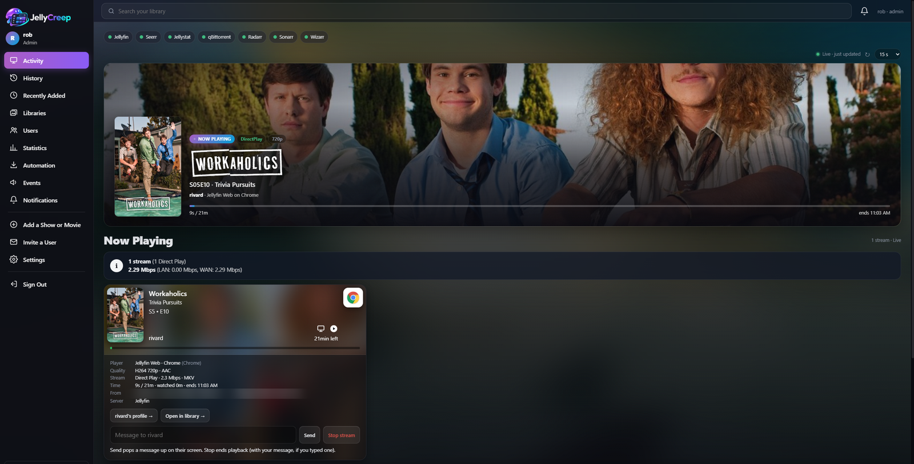
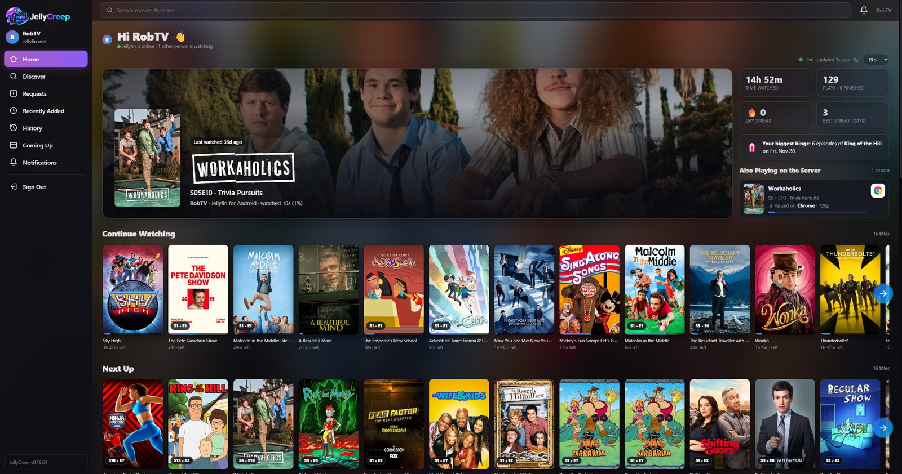
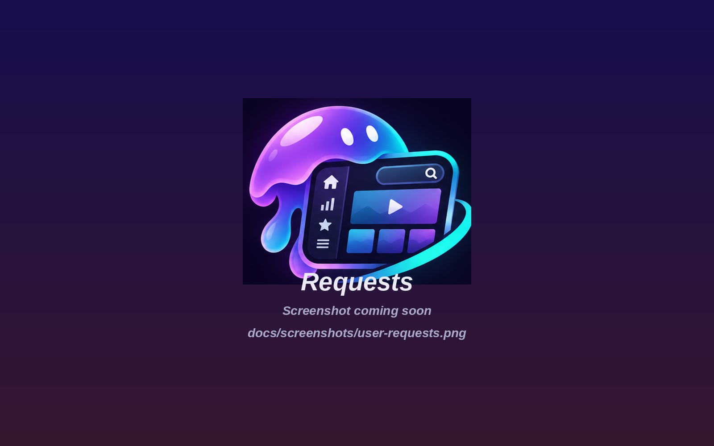
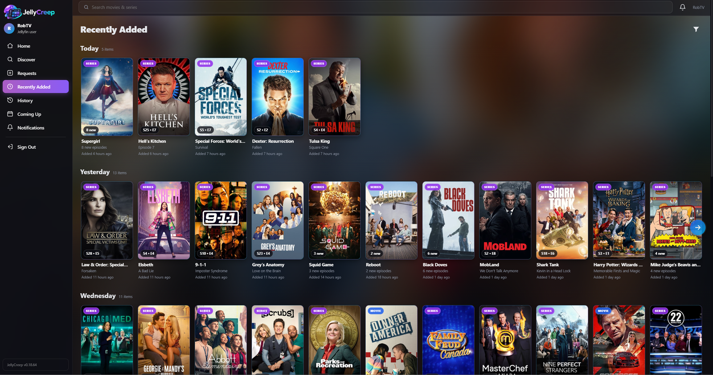
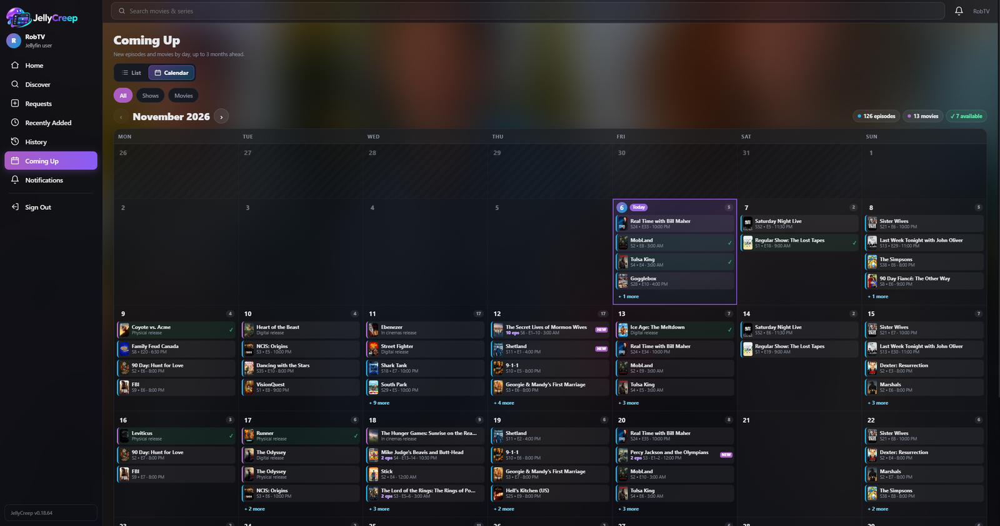
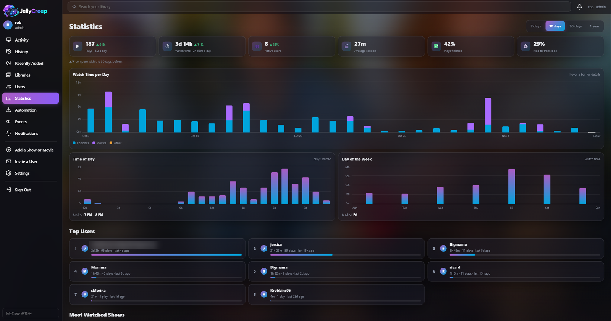
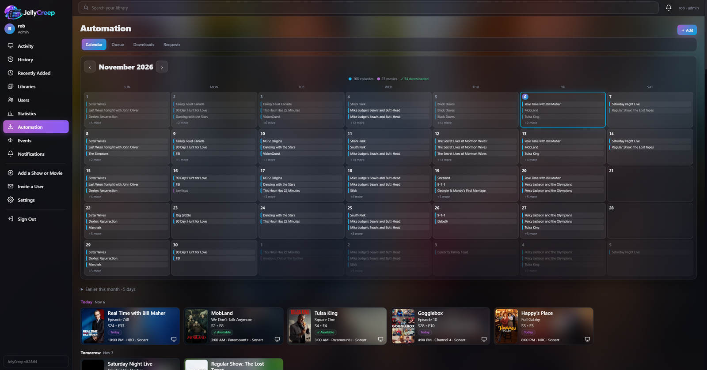
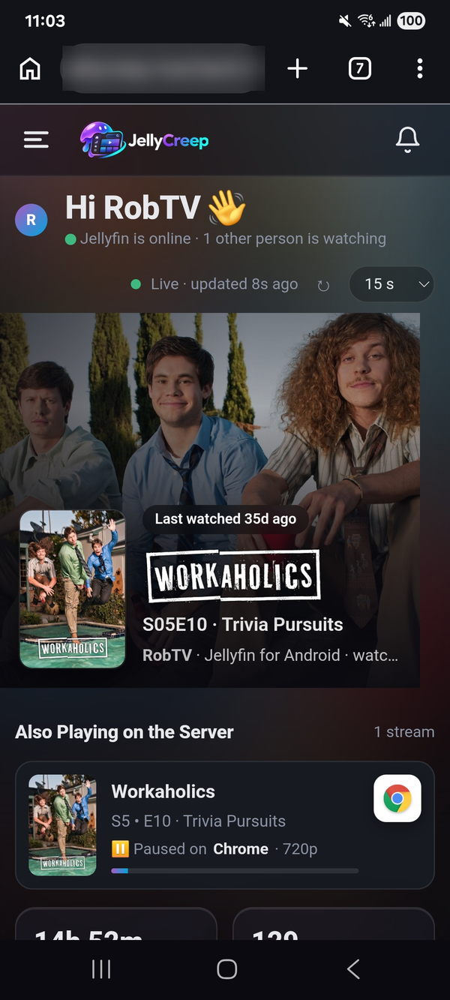
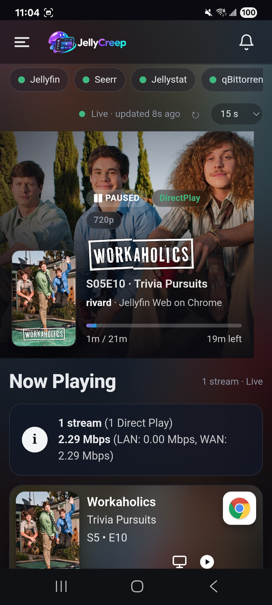

<p align="center">
  
</p>

<h1 align="center">JellyCreep</h1>

<p align="center">
  <b>A Tautulli-style dashboard for Jellyfin, with your whole *arr stack, Seerr requests and a personal page for every viewer, in one place.</b><br>
  Phone-first, quick to load, and built to sit behind Authentik MFA.
</p>

<p align="center">
  <a href="#quick-start">Quick start</a> ·
  <a href="#screenshots">Screenshots</a> ·
  <a href="#what-admins-get">Admin features</a> ·
  <a href="#what-jellyfin-users-get">Viewer features</a> ·
  <a href="#authentik">Authentik</a> ·
  <a href="#configuration">Configuration</a>
</p>

---

## The story (and a heads-up)

JellyCreep started out small. I wanted one page that showed my Sonarr, Radarr, SABnzbd and qBittorrent at a glance, and every one of those apps sits behind **Authentik with MFA**. Normal dashboards can't get past an MFA prompt, so I built one that logs in through Authentik with a service account.

Then it grew. It picked up live Jellyfin activity like Tautulli, then watch history, then stats, then Seerr requests. After that came Wizarr invites, push notifications, and a full, privacy-safe dashboard that my Jellyfin users can sign in to. It's now the main way my household and friends find, request and keep track of what's on the server.

> **🤖 This project is vibe-coded.** Almost all of the code was written by an AI (Claude) from my prompts, screenshots and feedback, then tested on my own homelab. It works well for me and I've tried to keep it safe: it's default-deny for viewers, passwords are never stored, and secrets are encrypted at rest. Even so, **read the code before you expose it to the internet**, keep it behind your reverse proxy, and please open an issue if you spot something.

---

## Screenshots

<table>
  <tr>
    <td width="50%"><br><sub><b>Activity</b>: live streams with device logos, Direct Play / Transcode, LAN/WAN bandwidth, stop and message</sub></td>
    <td width="50%"><br><sub><b>Home</b> (Jellyfin user): Continue Watching, Next Up, Coming Up and what else is playing</sub></td>
  </tr>
  <tr>
    <td width="50%"><br><sub><b>Discover</b>: Seerr rows, genres, networks and studios, with hover cards</sub></td>
    <td width="50%"><br><sub><b>Title page</b>: request, watch on Jellyfin, open in app, or play on a TV</sub></td>
  </tr>
  <tr>
    <td width="50%"><br><sub><b>Requests</b>: Seerr-style filters by type and status</sub></td>
    <td width="50%"><br><sub><b>Recently Added</b>: one row per day</sub></td>
  </tr>
  <tr>
    <td width="50%"><br><sub><b>Coming Up</b>: list or monthly calendar</sub></td>
    <td width="50%"><br><sub><b>Statistics</b>: plays per day, peak hours, weekdays, top titles</sub></td>
  </tr>
  <tr>
    <td width="50%"><br><sub><b>Automation</b>: queue, downloads, calendar, requests, indexers</sub></td>
    <td>
      <table><tr>
        <td></td>
        <td></td>
      </tr></table>
      <sub><b>On a phone</b>: installs as an app, with push notifications</sub>
    </td>
  </tr>
</table>

---

## Highlights

- **Live activity like Tautulli.** See who's watching what, on which device (with real app logos), Direct Play, Direct Stream or Transcode and the reason why, progress, time left, and LAN/WAN bandwidth. Stop a stream or pop a message up on someone's screen.
- **Its own watch history.** JellyCreep polls Jellyfin's sessions and records every play, minus paused time. You can import older history from Jellystat.
- **Your whole *arr stack on one page.** Sonarr, Radarr, Lidarr, Prowlarr, Bazarr, SABnzbd, qBittorrent and Seerr, even when every one of them is behind Authentik MFA.
- **A real app for your Jellyfin users.** They sign in with their Jellyfin account to discover and request titles, see what's coming, keep track of their history and get push notifications. They never see other people's names, IPs or anything admin.
- **Fast.** Pages are cached with stale-while-revalidate and warmed in the background, so most pages render in a few milliseconds and a slow or offline app never holds a page up.
- **Phone-first, desktop-polished.** It installs to the home screen and has swipeable rows on phones. Desktop gets a Seerr-style sidebar layout with arrow-scrolling rows.

---

## What admins get

Admins and members sign in through **Authentik** (forward auth or OIDC). Members of the `jellycreep-admins` group can also change settings, stop streams and send invites.

### Activity
- A Tautulli Remote-style card for each stream: poster, title, episode, the person, a **platform logo** (Android TV, Shield, Apple TV, iOS, Android, Roku, Fire TV, web browsers, Moonfin, Wholphin, Infuse, Kodi and more), type and play-method icons, and time left.
- **Instant updates**: JellyCreep listens to Jellyfin's own live connection (no plugin), so streams appear, pause and disappear within a second or two, on both the admin and viewer pages, with no refreshing.
- A summary line, e.g. *"3 streams (1 Direct Stream, 1 Direct Play, 1 Transcode) · 29.1 Mbps (LAN 15.1, WAN 14.0)"*.
- Expand a card for the player, the source → transcoded codecs and resolution, the bitrate, the **transcode reason in plain English**, the IP address with **location and ISP**, and the server.
- **Send message** pops a note up on the player. **Stop stream** ends it, with your message if you typed one.
- A full-width Jellyfin-style **hero** of what's playing (or what was watched last). Tap it to open that play's details.

### History
- Grouped by day, with search and a filter sheet: user, type, when, playback method, finished or not, and app. You can also group back-to-back episodes into a single "binge" card.
- Every play opens a **play details** page: timeline, progress, paused time, device, play method and transcode reason, IP, location and ISP.

### Users and profiles
- **Users** shows a card per person: live status, what they're watching now or watched last, plays, total and 30-day watch time, a 14-day sparkline, their share of all watching and their last IP and location. Sort by recent, most watched and more.
- Each **user profile** has a 30-day chart split by movies and TV, a month summary, favourite shows and movies, devices, an hour-of-day heatmap, streaks and their biggest binge.

### Statistics
Plays and watch time per day (movies vs TV, with hover tooltips), this period vs the last, busiest hours (12-hour clock) and weekdays, top users, movies and shows, play methods, clients, and peak concurrent streams and transcodes.

### Library and media
- **Recently Added**, laid out as one row per day.
- Movie, show, season and episode pages with cast, Rotten Tomatoes and audience scores, IMDb/TMDB/TVDB links, file info (container, size, bitrate, every audio and subtitle track) and who has watched it.
- **Media → Quality** shows how much of your library is 4K, 1080p or HDR/Dolby Vision, which codecs and containers you have, image-based subtitles, and a *transcode outlook* that ties those to the real reasons your streams transcode.
- **Media → Storage** shows every drive that Jellyfin and the *arrs can see, merged per disk, with free space, which libraries live where and a "full in ~N days" estimate.

### Automation
- The **Queue** across Sonarr, Radarr and Lidarr: retry or remove stuck items.
- **Downloads** from SABnzbd and qBittorrent: pause or resume everything or a single item. Failed jobs are flagged.
- A **Calendar** of upcoming episodes and movies, plus health checks and Prowlarr indexer status.
- **Subtitles** from Bazarr: what's still missing subtitles (and in which languages), recent downloads, paused providers and health. Kick off a search for everything missing.
- **Seerr requests**: approve or decline from your phone.
- **Search & add** shows and movies straight to Sonarr or Radarr.
- Each service is shown with its real logo, from [homarr-labs/dashboard-icons](https://github.com/homarr-labs/dashboard-icons).

### Invites (Wizarr)
Create an invite on your phone (server, libraries, expiry, access length, downloads and Live TV), then share it with your phone's share sheet. You can extend, disable, enable or delete Wizarr users.

### Logs and updates
- **Logs**: the last 3,000 log lines in the app, filterable by level and source (JellyCreep, calls to your apps, web requests), searchable, with Follow and Download. API keys and tokens are hidden.
- **Update check**: admins see a banner when a newer JellyCreep is on GitHub. After you redeploy, anyone with JellyCreep open gets a "JellyCreep has been updated: Reload" prompt.

### Events and notifications
- An **Events** timeline of grabs, imports, requests and health alerts, pushed in by webhooks from the *arrs, Seerr and Jellyfin.
- Alerts can go to **ntfy, Pushover, Discord** or any webhook: transcodes, failed downloads, apps going down or coming back, new requests and new users.
- **Web Push** sends notifications straight to phones and computers with no extra app. Admins can also send an **announcement** to everyone, viewers only or staff only.

### Settings
Add each app by URL and API key, with **Save & test**. You can also manage sign-in options, notifications and API tokens, and import from Jellystat. Secrets are stored encrypted.

---

## What Jellyfin users get

Turn on **Settings → Sign-in → Allow Jellyfin users to sign in**. Your users then go to `https://<your-jellycreep>/me` and sign in with their **Jellyfin username and password**. JellyCreep checks the password with Jellyfin and never stores it.

### Home
- **Continue Watching** and **Next Up**, straight from their Jellyfin account.
- **Coming Up**: the next episodes of the shows they watch, and upcoming movies.
- **New on Jellyfin**, **Recently requested**, and their own stats and streaks.
- **Also playing on the server**: what other people are watching, showing the title, progress and **device type** (TV, phone, browser…). It never shows **who** is watching, the device name, or where they are. Titles from libraries the viewer can't access just count as "N more streams".
- A card that tells them in plain English why their streams were converted and what they can do about it.

### Discover and requests (needs Seerr)
- Seerr-style rows: Trending, Popular, Upcoming, **movie genres and series genres**, **networks** and **studios**. Desktop has hover cards with the title, date and description.
- A **title page** for each movie or show with backdrop, trailer, cast (tap an actor for their filmography), ratings, "More like this", and **Request** / **Request in 4K** with a season picker.
- **Requests** with Seerr's filters (movies or shows, plus every status). People can cancel their own pending requests, and Seerr managers can approve or decline.
- Requests go through each person's own Seerr account, so their permissions, quotas and auto-approve rules all apply. JellyCreep can create those accounts automatically.

### Watching
- **▶ Watch on Jellyfin** (or **Resume from 12:34**, or the next episode of a show).
- **Open in app**: opens the title straight in **Moonfin** on Android. The official Jellyfin app can only be launched, not taken to a specific title.
- **Play on…** starts the title on one of their open Jellyfin apps (TV, phone or browser), resuming where they left off.

### The rest
- **Recently Added**, **Coming Up** (as a list or a monthly calendar), **Your History** (with filters and binge grouping) and library browsing. They only ever see libraries their Jellyfin account can access.
- **Push notifications**: when a request is approved or available, and when a new episode of a show they watch is added. Admin announcements always come through. Tap the 🔔 to turn them on.

### Privacy model
Viewers are **default-deny**. They're redirected to `/me`, and admin pages and APIs return 403. They never see other users' names, IP addresses, locations, device names, *arr URLs, file paths, downloads, storage or settings. A Jellyfin *administrator* who signs in this way is still only a viewer: admin access always goes through Authentik.

---

## Quick start

### Dockhand (what I use)

1. Create the shared Docker network once per host (skip this if you already have one, and set `PROXY_NETWORK` to its name):
   ```sh
   docker network create proxy
   ```
2. In Dockhand, go to **Stacks → Add from Git**:
   - Repository: `https://github.com/rivarob04/jellycreep`
   - Branch: `main`
   - Compose file: `compose.yaml`
3. Add the stack variables (mark secrets as *secret*). Only these are needed to start:

   | Variable | Value |
   |---|---|
   | `JELLYCREEP_BASE_URL` | `https://jellycreep.example.com` |
   | `JELLYFIN_URL` / `JELLYFIN_API_KEY` | e.g. `http://jellyfin:8096` / Dashboard → API Keys |
   | `JELLYCREEP_SECRET_KEY` | optional (`openssl rand -base64 48`). It's generated and saved in the data volume if you leave it out |

4. **Deploy**, then add your other apps from **Settings → Add a service**.

To update, use **Pull and Redeploy**. Every push to `main` builds a new image at `ghcr.io/rivarob04/jellycreep` with GitHub Actions. If the GHCR package is private, either make it public or let Dockhand build it (the compose file has `build: .` as a fallback).

### Plain Docker

```sh
git clone https://github.com/rivarob04/jellycreep && cd jellycreep
cp .env.example .env    # then edit it
docker compose up -d
```

By default the container listens on `127.0.0.1:8484`, so only your reverse proxy can reach it. Change `JELLYCREEP_PORT` / `JELLYCREEP_BIND` if you need something different.

### Connecting your apps

Every app is an existing install that you connect to, not a container JellyCreep runs. Add them in **Settings** or with `<APP>_URL` / `<APP>_API_KEY` variables.

| App | URL example | Credential |
|---|---|---|
| Jellyfin | `http://jellyfin:8096` | Dashboard → API Keys |
| Jellystat | `http://jellystat:3000` | Settings → API Keys |
| Wizarr | `http://wizarr:5690` | Settings → API Keys |
| Sonarr / Radarr / Lidarr / Prowlarr | `http://sonarr:8989` or `https://sonarr.example.com` | Settings → General → API Key |
| Bazarr | `http://bazarr:6767` | Settings → General → Security → API Key |
| SABnzbd | `http://sabnzbd:8080` | Config → General → **API Key** (not the NZB key) |
| qBittorrent | `http://qbittorrent:8080` | Web UI username + password |
| Seerr / Jellyseerr | `http://jellyseerr:5055` | Settings → General → API Key |

**Link URL.** For *Watch on Jellyfin* to work away from home, set the Jellyfin connection's **Link URL** (or `JELLYFIN_PUBLIC_URL`) to the address your phone uses, e.g. `https://jellyfin.example.com`.

---

## Authentik

### Protecting JellyCreep

**Option A: forward auth / proxy provider (recommended)**

1. In Authentik, go to **Applications → Create with provider → Proxy Provider**. Use *Forward auth (single application)* for nginx, Traefik, Caddy or NPM, or *Proxy* if the outpost serves the traffic.
2. Create a group named `jellycreep-admins` and add yourself.
3. Keep `AUTH_MODE=authentik_forward`. JellyCreep only trusts the `X-authentik-*` headers when they come from `TRUSTED_PROXIES` (localhost and Docker networks by default). If your proxy runs on another machine, set `JELLYCREEP_BIND=0.0.0.0` and `TRUSTED_PROXIES=<proxy IP>/32`.

A ready-to-use **nginx** config is in [`deploy/nginx/jellycreep.conf`](deploy/nginx/jellycreep.conf). It protects the UI and leaves `/api/` (which checks its own tokens) and the viewer pages open. If you use Authentik's *Unauthenticated Paths* instead, add `^/api/.*` and `^/healthz$`.

**Option B: OIDC login**

Create an OAuth2/OpenID provider with the redirect URI `https://jellycreep.example.com/auth/callback` and the `groups` scope, then set:

```
AUTH_MODE=oidc
OIDC_ISSUER=https://auth.example.com/application/o/<app-slug>
OIDC_CLIENT_ID=...
OIDC_CLIENT_SECRET=...
```

### Letting Jellyfin users in past Authentik

Viewer pages need to skip Authentik, because viewers sign in with Jellyfin instead. Put this in your JellyCreep server block, above `location /`. It strips the Authentik headers, so nobody can use it to fake an admin login.

```nginx
location ~ ^/(login|logout|me|partials/me)(/|$) {
    proxy_set_header X-authentik-username "";
    proxy_set_header X-authentik-groups   "";
    proxy_set_header X-authentik-email    "";
    proxy_pass http://jellycreep;
}
location /static/ { proxy_pass http://jellycreep; }
```

Then turn on **Settings → Sign-in** (or set `JELLYFIN_LOGIN=true`) and send people to `/me`.

### Reaching your *arr apps through Authentik MFA

This is the reason JellyCreep exists. An API client can't answer an MFA prompt, so JellyCreep logs in as an Authentik **service account**:

1. **Directory → Users → Create Service Account** (e.g. `svc-jellycreep`).
2. **Directory → Tokens and App passwords → Create** an *App password* for it.
3. Bind that account to each application (Sonarr, Radarr…).
4. In JellyCreep, open **Settings → (app) → Edit**, use the app's public URL and API key, and pick a **Proxy auth** mode:

| Mode | What JellyCreep sends | Use when |
|---|---|---|
| Authentik – username + app password | `Authorization: Basic …` | Simplest; works with proxy and forward-auth providers |
| Authentik – OAuth2 client credentials | A short-lived JWT, refreshed automatically | You want short-lived tokens on the wire |
| Custom headers | Whatever you list (e.g. Cloudflare Access) | Cloudflare Access, Pomerium, shared-secret headers |
| None | Only the app's own key | Same Docker network, LAN or VPN |

The app's own API key goes in `X-Api-Key`, so it doesn't clash with Authentik. The Authentik session cookie is reused between polls. **Save & test** tells you plainly when a request hits Authentik's login page. With forward auth, make sure your proxy passes the `Authorization` header through to the outpost.

---

## Push notifications

Tap the **🔔** at the top right, then **Turn on for this device**. It uses standard Web Push, so there's no ntfy, Firebase or extra app to set up.

- JellyCreep must be served over **https://**.
- The container needs outbound HTTPS to the push services (`fcm.googleapis.com`, `*.push.apple.com`, `updates.push.services.mozilla.com`).
- iPhone users must **Add to Home Screen** first (iOS 16.4+).
- Keys are generated automatically. Set `VAPID_SUBJECT=mailto:you@example.com` to add a contact address.

---

## Configuration

Everything except the first few variables can also be set in the UI. The full list is in [`.env.example`](.env.example).

| Variable | Default | What it does |
|---|---|---|
| `JELLYCREEP_BASE_URL` | – | Public URL, used for links and push |
| `JELLYCREEP_SECRET_KEY` | generated | Encrypts stored secrets and signs sessions |
| `TZ` | `UTC` | Time zone for charts, history and the calendar |
| `JELLYCREEP_PORT` / `JELLYCREEP_BIND` | `8484` / `127.0.0.1` | Where the container listens |
| `PROXY_NETWORK` | `proxy` | Existing Docker network shared with your proxy and apps |
| `AUTH_MODE` | `authentik_forward` | `authentik_forward`, `oidc` or `none` |
| `TRUSTED_PROXIES` | localhost + Docker | Who may send `X-authentik-*` headers |
| `TRUSTED_PROXY_SECRET` | – | Recommended. A long random string your proxy also sends as `X-JellyCreep-Proxy-Secret`. When set, Authentik headers that arrive without it are ignored |
| `ADMIN_GROUP` | `jellycreep-admins` | Authentik group with admin rights |
| `JELLYFIN_LOGIN` | `false` | Let Jellyfin users sign in at `/login` |
| `ADMIN_LOGIN_URL` | – | Optional "admin sign-in" link on the login page |
| `OIDC_ISSUER` / `OIDC_CLIENT_ID` / `OIDC_CLIENT_SECRET` | – | For `AUTH_MODE=oidc` |
| `POLL_INTERVAL` | `10` | Seconds between Jellyfin session polls |
| `MIN_WATCH_SECONDS` | `30` | Shorter plays aren't recorded |
| `WATCHED_PERCENT` | `90` | Counted as finished at this progress |
| `HISTORY_RETENTION_DAYS` | `0` | `0` keeps history forever |
| `GEOIP` | `ipwhois` | Set to `off` to stop looking up IP locations (via ipwho.is) |
| `UPDATE_CHECK` | `on` | Checks GitHub every 6 hours for a newer JellyCreep and tells admins. `off` to disable |
| `VAPID_SUBJECT` | – | Contact address for Web Push |
| `<APP>_URL`, `<APP>_API_KEY`, `<APP>_PROXY_AUTH`, `<APP>_PUBLIC_URL` | – | Connect an app from variables instead of Settings |
| `AUTHENTIK_URL`, `AUTHENTIK_SERVICE_USERNAME`, `AUTHENTIK_SERVICE_APP_PASSWORD` | – | Service account for apps behind Authentik |

---

## Webhooks and API

**Webhooks → Events.** Create a token in **Settings → API tokens**, then point each app's webhook at:

```
https://jellycreep.example.com/api/v1/webhook/<source>?apikey=<token>
```

`<source>` is `sonarr`, `radarr`, `lidarr`, `prowlarr`, `jellyseerr` or `jellyfin` (Jellyfin needs the Webhook plugin, using a *Generic* destination). Settings shows every URL with a copy button.

**Read-only REST API.** Send `X-Api-Key: <token>` with each request. It works well with Homepage and scripts. Interactive docs are at `/api-docs` (for signed-in admins and members).

| Endpoint | |
|---|---|
| `GET /api/v1/activity` | Current streams |
| `GET /api/v1/history` | Watch history (`user_name`, `type`, `q`, `method`, `limit`, `offset`) |
| `GET /api/v1/users` | Per-user totals |
| `GET /api/v1/stats?days=30` | Aggregates |
| `GET /api/v1/events` | Webhook events |
| `GET /api/v1/services` | Connection status |

---

## Known limitations

- **Wholphin** ignores remote "play" commands, so it's left out of *Play on…*. It does show messages.
- The official **Jellyfin Android app** can't be opened at a specific title, only launched. **Moonfin** can.
- The **Jellyfin iOS app** doesn't display messages sent from the server.
- Roku, Samsung and LG TV apps get a generic TV icon.
- Rotten Tomatoes scores need a metadata provider that supplies them (e.g. the OMDb plugin).
- IP locations come from a free lookup service and are approximate. Set `GEOIP=off` if you'd rather not use it.

---

## Development

```sh
python -m venv .venv && . .venv/bin/activate
pip install -r requirements.txt
DATA_DIR=./data AUTH_MODE=none COOKIE_SECURE=false uvicorn app.main:app --reload --port 8484
```

**Stack:** FastAPI, Jinja2, SQLAlchemy on SQLite (WAL) and httpx. The front end is plain CSS and a small vanilla JS file, with no framework and no CDN, so everything is served locally. Responses are gzipped and static files are cached forever with versioned URLs.

## Credits

- Service logos: [homarr-labs/dashboard-icons](https://github.com/homarr-labs/dashboard-icons)
- Movie and show artwork and metadata: [TMDB](https://www.themoviedb.org/), via Seerr. *This product uses the TMDB API but is not endorsed or certified by TMDB.*
- IP locations: [ipwho.is](https://ipwho.is)
- Inspired by [Tautulli](https://tautulli.com), [Tautulli Remote](https://github.com/Tautulli/Tautulli-Remote), [Jellyseerr/Seerr](https://github.com/Fallenbagel/jellyseerr), [Jellystat](https://github.com/CyferShepard/Jellystat) and Moonfin
- Written with [Claude](https://claude.ai) 🤖
